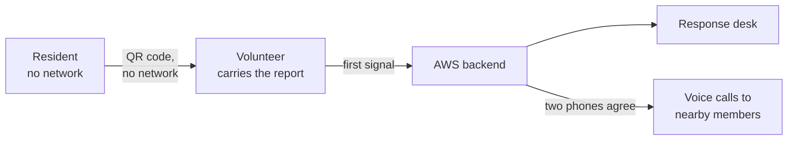
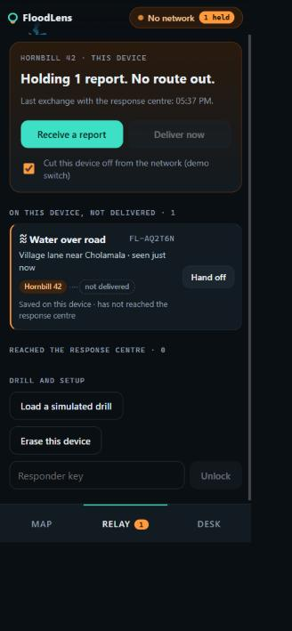
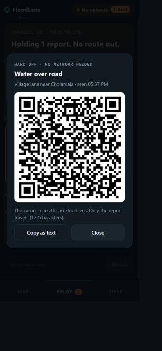
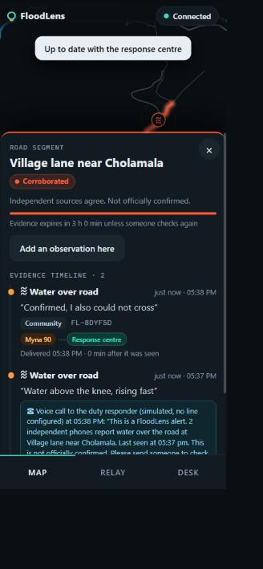
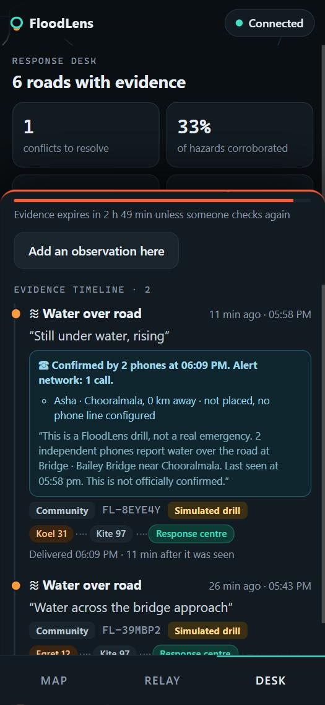
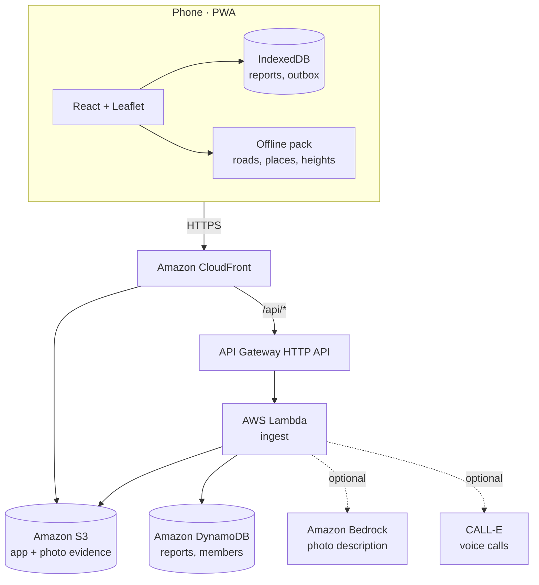

<div align="center">

# FloodLens

**Know what changed. Know what is verified. Carry it out when the network is gone.**

Offline-first road-condition evidence for floods and landslides.

[Live app](https://d24y0wbvz1jjie.cloudfront.net) · [Demo video](docs/floodlens-demo.mp4) · [Screenshots](docs/screens)

WeMakeDevs × AWS Environmental Hacks 2026 · Track: Heat and Water

</div>

---

## The problem

After a flood or landslide, the map still shows a bridge that is no longer there, and the phone network is often down. Residents, volunteers and responders each hold a piece of the picture, with no reliable way to share it or to tell how old it is.

On 11 October 2026 a flash flood on Nepal's Budhi Gandaki river swept away footbridges and road bridges in Gorkha district. In September 2024, landslides blocked three highways into Kathmandu, and vehicles queued behind a blockage were buried. In both cases, knowing which crossings were gone depended on someone reaching a place with signal.

FloodLens does not predict floods or declare roads safe. It shortens the time between someone seeing a broken road and a responder knowing about it, and it stops old information from looking current.

## How it works



1. **Report.** A resident taps the road on an offline map, picks the hazard and can add a photo. The report is saved on the phone and labelled *saved, not delivered*.
2. **Hand off.** The report becomes a QR code of about 110 characters. A second phone scans it and becomes its carrier. No network is involved.
3. **Deliver.** Whichever device reaches signal first uploads what it holds. The same report arriving by two routes is stored once, with both routes recorded.
4. **Weigh the evidence.** Each road gets a status from the observations on it, and every observation expires.
5. **Alert.** When two independent phones confirm a hazard, responders and members living within 3 km get an automated voice call.

## Evidence states

Every road segment is in exactly one state. No state means "safe".

| State | Meaning |
|---|---|
| Unknown | No observation on record. |
| Hazard reported | One source. Not yet corroborated. |
| Corroborated | Two independent devices agree. Not officially confirmed. |
| Conflicting reports | A hazard and a "passed through" at the same time. Both are kept and the road is flagged for a fresh check; they are never averaged. |
| Recently passable | Someone got through recently. Not a guarantee. |
| Closed · verified / Open · verified | Recorded by an authorised responder. |
| Stale | The evidence has outlived its time-to-live. The road is unknown again. |

Time-to-live depends on the hazard: 3 hours for water over a road, 12 for a landslide, 24 for a damaged bridge. The **time lens** on the map shows what will still be known in N hours if nobody checks again.

## Features

| | |
|---|---|
| **Offline map** | Real OpenStreetMap roads, bridges, rivers and villages for Meppadi–Chooralmala, Wayanad, bundled in the app. No map tiles to download. |
| **Offline reporting** | Reports, photos and the outbox live in IndexedDB. The app is an installable PWA. |
| **QR store-carry-forward** | Phone-to-phone handoff without any network. Importing the same code twice never duplicates a report. |
| **Idempotent delivery** | DynamoDB conditional writes keep one record per report, however many carriers deliver it. |
| **Alert network** | Opt-in voice calls through the CALL-E API when a hazard near a member's home is corroborated. One round of calls per road. Phone numbers never leave the backend. |
| **Higher-ground guide** | Lists mapped places within 3 km that are at least 10 m higher, with distance, height gain and hazards reported near the direct line. Works offline from bundled ground heights. |
| **Street view link** | With a connection, opens street-level imagery for a road or a higher-ground option. |
| **Response desk** | Inspection queue ordered by urgency, with corroboration rate, stale count and median seen-to-delivered time. |

<p align="center">
  
  
  
  
</p>

## Architecture



### How AWS is used

| Service | Role |
|---|---|
| **CloudFront + S3** | Serves the PWA over HTTPS (required for the camera and the service worker) and stores photo evidence. |
| **API Gateway + Lambda** | `/api/sync` ingests report batches from any carrier, `/api/reports` returns the shared picture, `/api/members` manages the alert network. |
| **DynamoDB** | One item per report, written with `attribute_not_exists` so concurrent carriers cannot create duplicates. |
| **Bedrock** | Describes each photo in one sentence for the reviewer. It never sets a road status. |
| **SAM** | The whole stack is defined in [`backend/template.yaml`](backend/template.yaml). |

The ingest logic in [`backend/src/core.mjs`](backend/src/core.mjs) is independent of AWS. The Lambda entry point and the local development server both wrap it.

## Getting started

Requires Node.js 22 or newer.

```bash
npm --prefix web install
node backend/local.mjs
npm --prefix web run dev
```

Open `http://localhost:5173`. For a second, separate device in the same browser, open `http://localhost:5173/?device=B`. Add `?demo` to show the rehearsal controls: a simulated drill and a network-cut switch. The local responder key is `drill-2026`.

To test on real phones over the same Wi-Fi, run `npm --prefix web run dev:phones` and open the printed `https://<laptop-ip>:5443` address.

### Tests

```bash
npm --prefix web test          # evidence rules and QR format
node backend/test-alerts.mjs   # who the alert network calls
node backend/test-calle.mjs    # call request and guards (places no call)
```

### Deploy to AWS

Requires the AWS CLI and SAM CLI with credentials configured.

```bash
npm --prefix web run build
sam deploy --guided --template-file backend/template.yaml --stack-name floodlens --capabilities CAPABILITY_IAM
aws s3 sync web/dist s3://<SiteBucket output> --delete
```

| Parameter | Purpose |
|---|---|
| `ResponderKey` | Shared key that unlocks verified closures. Stands in for user accounts in this prototype. |
| `CalleApiKey` | Optional. Enables real voice calls. |
| `CalleAllowedNumbers` | Optional. Restricts dialling to a fixed list of numbers. |
| `BedrockModelId` | Optional. Vision model or inference profile for photo descriptions. |

## Project structure

```
web/src/lib/status.js     evidence rules (pure functions, tested)
web/src/lib/codec.js      QR payload format
web/src/lib/sync.js       outbox and delivery
web/src/lib/guide.js      higher-ground options
web/src/components/       map, sheets, relay and desk panels
backend/src/core.mjs      ingest, deduplication, alert targeting
backend/src/aws.mjs       Lambda entry point (DynamoDB, S3, Bedrock)
backend/src/calle.mjs     CALL-E voice-call adapter
backend/template.yaml     AWS SAM stack
scripts/                  builds the offline pack from OpenStreetMap
tools/                    regenerates the demo video by driving the real app
```

## Status and limitations

**Verified**

- The full flow (offline report, QR handoff, delivery, deduplication, corroboration, expiry, response desk) in a desktop browser against the live AWS deployment.
- One real CALL-E voice call, placed from the local backend to a consenting number.
- The evidence rules, alert targeting and call adapter, by automated tests.

**Not yet verified**

- Camera QR scanning and photo capture on physical phones.
- Bedrock photo descriptions: the model is configured on the live stack, but the AWS account was still under Bedrock verification at submission time.
- Voice calls from the deployed stack: they are switched off there, and the alert network records who would be called.

**Not built**

- Wi-Fi Direct and LoRa handoff, an SMS fallback for weak signal, an inbound voice line.
- Responder accounts (a shared key stands in) and leaving the alert network from inside the app.
- Routing. The higher-ground guide compares ground height for rising water; it is not a route and knows nothing about landslide risk.

The simulated drill loads invented observations on real roads and labels them as simulated wherever they appear. FloodLens makes no claim about lives saved.

## Acknowledgements

Map data © [OpenStreetMap](https://www.openstreetmap.org/copyright) contributors, ODbL. Ground heights from the [Open-Meteo](https://open-meteo.com/) elevation API. Voice calls by [CALL-E](https://heycall-e.com).
